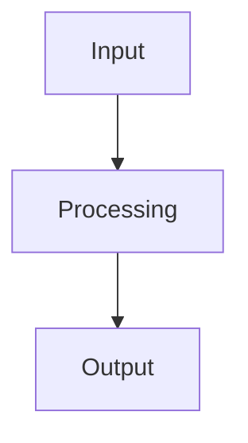

# report-formatting

## Overview

This skill defines the formatting standards and quality checklist for generating publication-quality research reports. It supplements the Report Agent's system prompt with detailed formatting rules.

## Instructions

### 1. Document Structure

The report must follow this structure in order:

1. **Title** — Concise, descriptive, reflecting the core research question
2. **Abstract** (200-300 words) — Background, problem, method, findings, significance
3. **Keywords** (5-8 terms) — Domain-specific, ordered by specificity
4. **Introduction** — Context → Problem → Motivation → Contribution → Structure overview
5. **Literature Review** — Thematic organization, critical synthesis, research gaps
6. **Methodology / Proposed Approach** — Framework, mechanisms, theoretical basis
7. **Evaluation & Feasibility** — Metrics, comparison tables, risk assessment
8. **Conclusion & Future Work** — Summary, limitations, open questions
9. **References** — GB/T 7714-2015 format

### 2. Citation Rules

- In-text citations use numbered brackets: `[1]`, `[2, 5]`, `[3-7]`
- Every `[x]` in the text must have a corresponding entry in References
- No reference entry should be orphaned (unused in text)
- References must come exclusively from `Inputs/raw/collected_papers.md`
- Never fabricate references

### 3. Formula Formatting

Use LaTeX for all mathematical expressions:
- Inline: `$E = mc^2$`
- Block-level:
  ```
  $$
  \nabla \cdot \mathbf{E} = \frac{\rho}{\epsilon_0}
  $$
  ```
- Number important equations: `$$ ... \tag{1} $$`

### 4. Diagram Guidelines

Use Mermaid syntax for architectural and flow diagrams:



- Keep diagrams focused (≤15 nodes)
- Use descriptive node labels
- Add a caption below each diagram

### 5. Table Formatting

Use Markdown tables for comparisons:
- Always include a header row
- Align numeric columns to the right
- Bold the best-performing values
- Add a caption above each table

### 6. Quality Checklist

Before finalizing, verify:
- [ ] All claims are supported by cited references
- [ ] No fabricated data or references
- [ ] All formulas are syntactically correct LaTeX
- [ ] All diagrams render correctly in Mermaid
- [ ] Abstract accurately reflects the report content
- [ ] Conclusion addresses the original research question
- [ ] Language is formal, objective, and consistent
