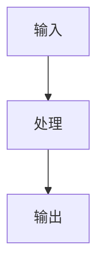

# report-formatting（报告格式化）

## 概述

本技能定义了生成出版级研究报告的格式化标准和质量检查清单，为 Report Agent 的系统提示提供详细的格式化规则补充。

## 操作指引

### 1. 文档结构

报告必须按以下顺序组织：

1. **标题** — 简洁、描述性强，反映核心研究问题
2. **摘要**（200-300 字）— 背景、问题、方法、发现、意义
3. **关键词**（5-8 个）— 领域专业术语，按专业程度排序
4. **引言** — 背景 → 问题 → 动机 → 贡献 → 结构概览
5. **文献综述** — 主题式组织、批判性综合、研究空白
6. **研究方法/提出的方案** — 框架、机制、理论基础
7. **评估与可行性论证** — 指标、对比表格、风险评估
8. **结论与展望** — 总结、局限性、开放问题
9. **参考文献** — GB/T 7714-2015 格式

### 2. 引用规范

- 正文引用使用编号方括号：`[1]`、`[2, 5]`、`[3-7]`
- 正文中每个 `[x]` 必须在参考文献中有对应条目
- 参考文献中不应有孤立条目（正文中未使用的）
- 参考文献必须完全来源于 `Inputs/raw/collected_papers.md`
- 严禁编造参考文献

### 3. 公式格式

所有数学表达式使用 LaTeX 格式：
- 行内公式：`$E = mc^2$`
- 块级公式：
  ```
  $$
  \nabla \cdot \mathbf{E} = \frac{\rho}{\epsilon_0}
  $$
  ```
- 重要公式编号：`$$ ... \tag{1} $$`

### 4. 图表指南

使用 Mermaid 语法绘制架构图和流程图：



- 保持图表聚焦（≤15 个节点）
- 使用描述性的节点标签
- 在每张图表下方添加说明文字

### 5. 表格格式

使用 Markdown 表格进行对比：
- 始终包含表头行
- 数值列右对齐
- 加粗最优值
- 在每张表格上方添加标题

### 6. 质量检查清单

定稿前逐项验证：
- [ ] 所有论断都有引用的参考文献支撑
- [ ] 无编造的数据或参考文献
- [ ] 所有公式语法正确（LaTeX）
- [ ] 所有图表可正确渲染（Mermaid）
- [ ] 摘要准确反映报告内容
- [ ] 结论回应了原始研究问题
- [ ] 语言正式、客观、风格一致
